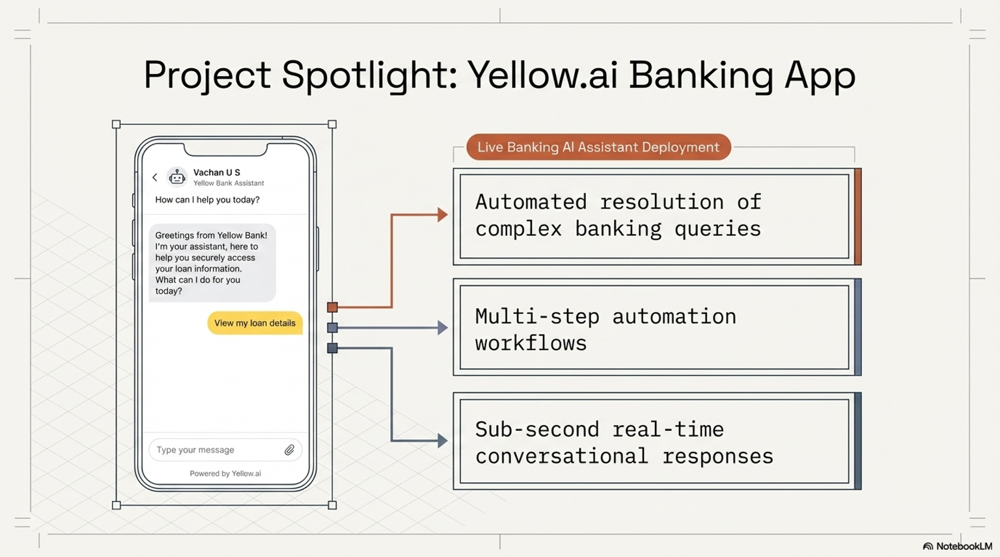
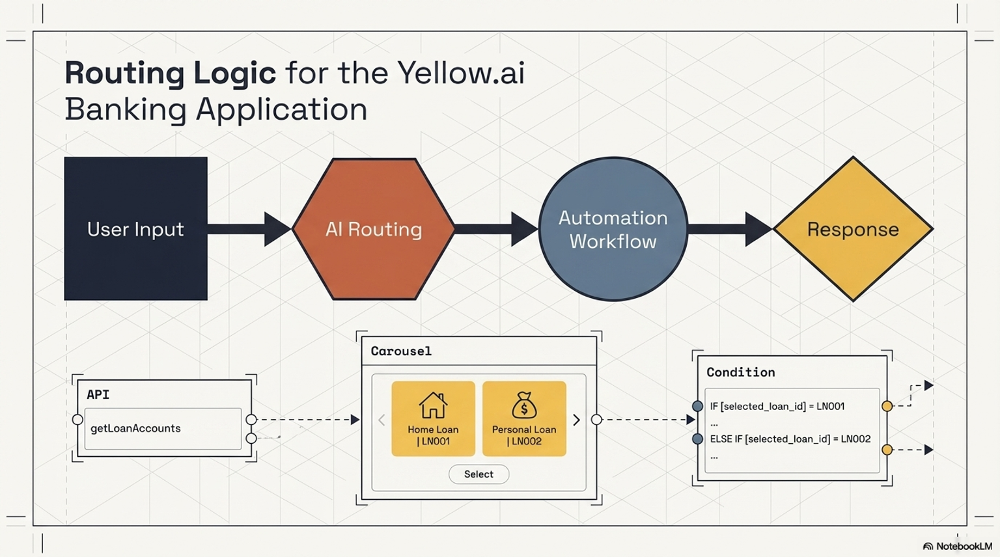
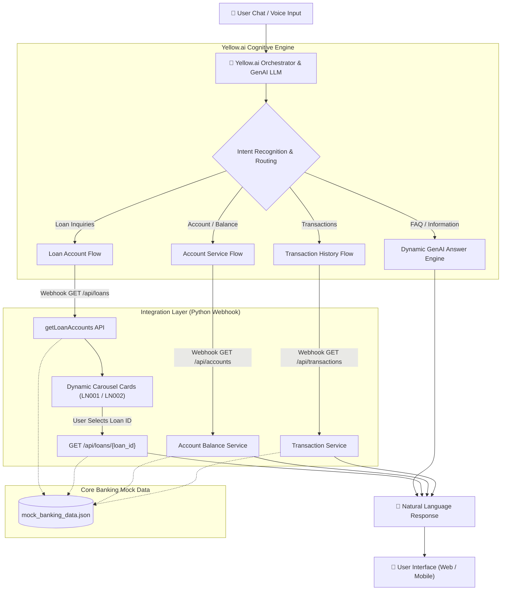

<div align="center">


# AI Banking Agent – Yellow.ai (Gen AI)

**A next-generation conversational banking assistant powered by Generative AI, intelligent intent routing, and real-time backend API integrations.**

[](https://github.com/vachan18/Gen-AI-banking-agent/actions/workflows/ci.yml)
[](https://cloud.yellow.ai/liveBot/x1774959469287?region=r0)
[](https://python.org)
[](https://yellow.ai)
[](https://flask.palletsprojects.com/)
[](LICENSE)

---

### 🌐 [Click Here to Test the Live Banking Assistant](https://cloud.yellow.ai/liveBot/x1774959469287?region=r0)

</div>

---

## 📌 Executive Summary

Modern banking customers expect instant, 24/7 self-service across accounts, loans, and transaction services without wait times. This project implements a **production-ready conversational AI banking agent** built on **Yellow.ai's Generative AI platform**, coupled with Python webhook integrations and banking core APIs.

### Key Highlights
- **GenAI-Powered Live Banking Assistant**: Built using Yellow.ai, automating end-to-end customer interactions including account assistance, transaction support, and zero-latency FAQ resolution.
- **Intelligent Conversational Workflows**: Designed structured flows with intent handling, dynamic slot filling, AI Agents, and AI-driven flow optimization to enhance real-time conversational UX.
- **Robust API & Webhook Integrations**: Engineered webhook integrations, structured JSON data pipelines, and Python scripting for seamless, secure API communication between banking backends and the conversational agent.
- **Sub-Second Response Times**: Delivers rich interactive UI components (interactive cards, carousels, quick replies) paired with LLM fallback for conversational questions.

---

## 📸 Interface & System Visuals

### 1. Live Banking AI Assistant Deployment
Automated resolution of complex banking queries, multi-step automation workflows, and sub-second real-time conversational responses.

<div align="center">
  
</div>

---

### 2. Intelligent Routing & Workflow Architecture
End-to-end workflow highlighting `User Input` $\rightarrow$ `AI Routing` $\rightarrow$ `Automation Workflow` $\rightarrow$ `Response`, powered by `getLoanAccounts` API endpoints and conditional branching.

<div align="center">
  
</div>

---

## 🏗️ Technical Architecture



---

## ⚡ Core Functionalities

### 1. Dynamic Loan Accounts & Carousel Rendering
- Queries the `getLoanAccounts` endpoint in real-time.
- Dynamically renders interactive loan cards (e.g., **Home Loan | LN001** and **Personal Loan | LN002**).
- Triggers contextual conditional logic based on customer selection:
  ```
  IF [selected_loan_id] == 'LN001' -> Fetch Home Loan Outstanding & Next EMI Date
  ELSE IF [selected_loan_id] == 'LN002' -> Fetch Personal Loan Outstanding & Interest Rate
  ```

### 2. Account Assistance & Balance Check
- Authenticated account inquiries delivering current available balance, account tier, and branch details.
- Secure data masking for customer identification.

### 3. Transaction Support & Statement Retrieval
- Instant lookup for recent debits, credits, UPI payments, and automated EMI debits.

### 4. GenAI FAQ & Fallback Resolution
- Handles open-ended banking inquiries (interest rate policies, branch timings, KYC verification steps) using generative responses grounded in verified banking knowledge bases.

---

## 🛠️ Tech Stack & Skills

| Domain | Technology / Tool |
| :--- | :--- |
| **Conversational AI Platform** | [Yellow.ai](https://yellow.ai) (Dynamic Flow Builder, Gen AI Bot Engine) |
| **Backend Integration** | Python 3.9+, Flask, REST APIs, Webhook Handlers |
| **Data Format** | JSON (JavaScript Object Notation), Schema Validation |
| **AI & Automation** | Intent Handling, Slot Extraction, Generative AI, Prompt Engineering |
| **Deployment & Testing** | Yellow.ai Cloud Console, Local Webhook Server, Postman |

---

## 📂 Project Repository Structure

```
├── Picture2.png                 # Architectural routing diagram & workflow logic
├── Picture3.png                 # Mobile UI spotlight & deployment overview
├── yellowdotai_logo.jpg         # Yellow.ai platform branding asset
├── webhook_server.py            # Python Flask webhook & banking API microservice
├── requirements.txt             # Python dependencies
├── data/
│   └── mock_banking_data.json   # Mock banking datasets (loans, accounts, transactions)
├── .gitignore                   # Standard ignore rules
└── README.md                    # Project documentation
```

---

## 🚀 Running the Webhook Backend Locally

### 1. Clone the Repository
```bash
git clone https://github.com/vachan18/Gen-AI-banking-agent.git
cd Gen-AI-banking-agent
```

### 2. Create and Activate Virtual Environment
```bash
# Windows
python -m venv venv
.\venv\Scripts\activate

# macOS / Linux
python3 -m venv venv
source venv/bin/activate
```

### 3. Install Dependencies
```bash
pip install -r requirements.txt
```

### 4. Start the Service
```bash
python webhook_server.py
```
*The server will start on `http://127.0.0.1:5000`.*

### 5. Test Endpoints
```bash
# Fetch Loan Accounts
curl http://127.0.0.1:5000/api/loans

# Fetch Specific Loan (LN001)
curl http://127.0.0.1:5000/api/loans/LN001

# Fetch Account Details
curl http://127.0.0.1:5000/api/accounts
```

---

## 🔗 Live Yellow.ai Project Link

Test the interactive bot directly in the Yellow.ai cloud environment:  
👉 **[Launch Yellow.ai Live Banking Bot](https://cloud.yellow.ai/liveBot/x1774959469287?region=r0)**

---

## 👨‍💻 Author

**Vachan U S**  
- **GitHub**: [@vachan18](https://github.com/vachan18)  
- **Portfolio**: [devfolio.co/@Vachanus](https://devfolio.co/@Vachanus)  
- **Email**: vachanus@gmail.com

---

## 📄 License
This project is licensed under the MIT License - see the [LICENSE](LICENSE) file for details.
